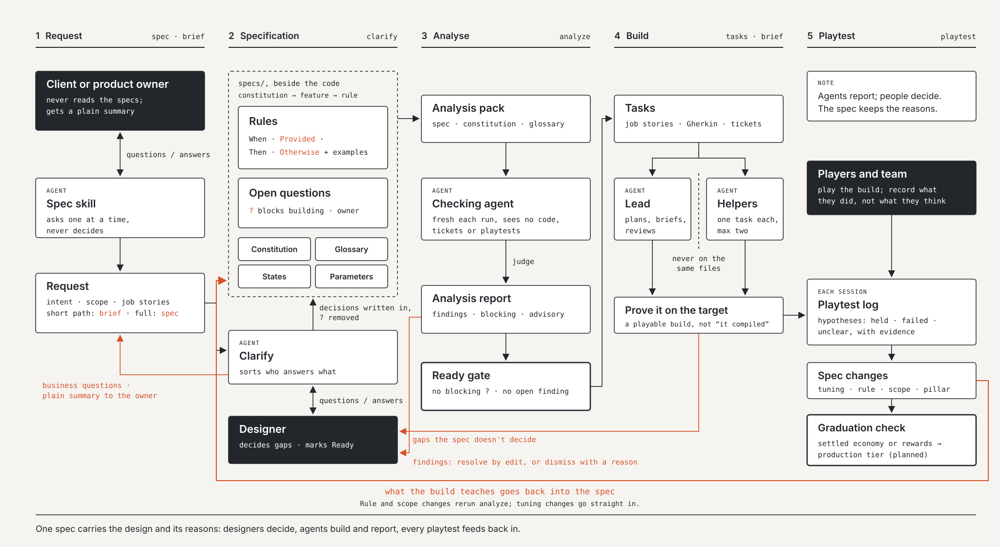

# Design-led SDD

**Spec-driven development for game teams working with AI agents, led by design.** Design leads, code follows, and every playtest feeds back into the spec, with the reasons kept.



Most spec-driven tools assume software: write a spec, plan, build, done. Games find their design by being played, so the spec has to change after every playtest without losing why. This method keeps the discipline of a spec (agents build from it, gaps are visible, decisions are written down) and adds the loop games need. It ships as a Claude Code plugin marketplace.

| Plugin | Tier | Status |
| --- | --- | --- |
| `dl-prototype` | Prototype: light specs for finding the fun | 0.2.1 |
| `dl-production` | Production: rules kept true across many changes | Planned |

## Read

| | |
| --- | --- |
| [Method guide](docs/method-guide.md) | The whole method in eight sections |
| [Worked example](docs/worked-example.md) | One feature taken once round the loop, from request to playtest |
| [Cheat sheet](docs/cheat-sheet.pdf) | One A4 page: skills, rule format, gates ([HTML](docs/cheat-sheet.html), [PNG](docs/cheat-sheet.png)) |
| [Method flow](docs/dl-prototype-flow.svg) | The diagram above, as an editable SVG |
| [Landing page](docs/index.html) | The project site, published with GitHub Pages from `docs/` |

## Install

In Claude Code:

```
/plugin marketplace add <this repository's URL or local path>
/plugin install dl-prototype@design-led-sdd
```

To try it without installing: `claude --plugin-dir ./plugins/dl-prototype`

## Two starts

| | New game | Existing game |
| --- | --- | --- |
| Skill | `/dl-prototype:constitution` | `/dl-prototype:adopt` |
| First job | Write down intent: pillars, platforms, boundaries, agent rules | Take stock of existing docs, code and registers; change none of them |
| Feature specs | Written before building | Written when a feature is next changed: spec the change, not the game |

## Eight skills

Each skill runs one step in Claude Code and asks one question at a time, as multiple choice. You can also just describe what you want; the skills load by themselves.

| Skill | What it does |
| --- | --- |
| `constitution` | New game: sets up the constitution, AGENTS.md, open questions, glossary, state file |
| `adopt` | Existing game: drafts the project layer from existing docs, imports open questions, maps old docs to features |
| `spec` | Full path: writes or revises a feature spec |
| `brief` | Short path: one-page brief for a small change, optionally handed to a helper agent |
| `clarify` | Works open questions down until a spec can be marked Ready |
| `analyze` | Independent consistency check across specs, by a separate agent; read-only |
| `tasks` | Job stories, Gherkin acceptance criteria and per-discipline tasks, ready for tickets |
| `playtest` | Records a playtest and turns it into spec changes |

## What it puts in your project

```
AGENTS.md                     rules for any agent, read first
CLAUDE.md                     @AGENTS.md
specs/
  constitution.md             the game in one screen
  STATE.md                    where the work is; read first every session
  glossary.md                 words with a special meaning
  open-questions.md           every undecided place, with an owner
  sources.md                  existing games: old documents mapped to features
  features/F001-name/         spec.md, tasks.md, playtest-log.md, analysis reports
  briefs/B001-name.md         short-path changes
  overrides/templates/        your versions of any template; these win
```

## Repository layout

```
.claude-plugin/marketplace.json     the marketplace
plugins/dl-prototype/
  .claude-plugin/plugin.json
  principles/                       the method, for people
  templates/                        the shapes the skills fill in
  skills/                           the procedures, for agents
docs/                               landing page, guides, cheat sheet, diagram
examples/tidepool-keeper/           a small fictional game, to show the format
tools/build_docs.py                 rebuilds docs/*.html from the Markdown
CHANGELOG.md
```

After editing `docs/method-guide.md` or `docs/worked-example.md`, run `python3 tools/build_docs.py` to refresh their HTML pages.

## Where it comes from

- A studio's working method from a mobile game in production: the AI-first loop, job stories with Gherkin criteria, Definitions of Ready and Done, the open questions register.
- [GitHub Spec Kit](https://github.com/github/spec-kit): the constitution, the clarify and analyse gates, short and full paths, tasks handed to tickets, layered overrides, new and existing project starts.
- [Proviso](https://github.com/bbak/proviso) by Bruno Baketarić: guarded rules with `Otherwise`, undecided places that block building, who decides what, and checking agents kept apart from the work. The production tier will draw on it further.

## Licence

Not yet decided. All rights reserved until a licence is added.

Design-led SDD is by Rob Sandberg.
