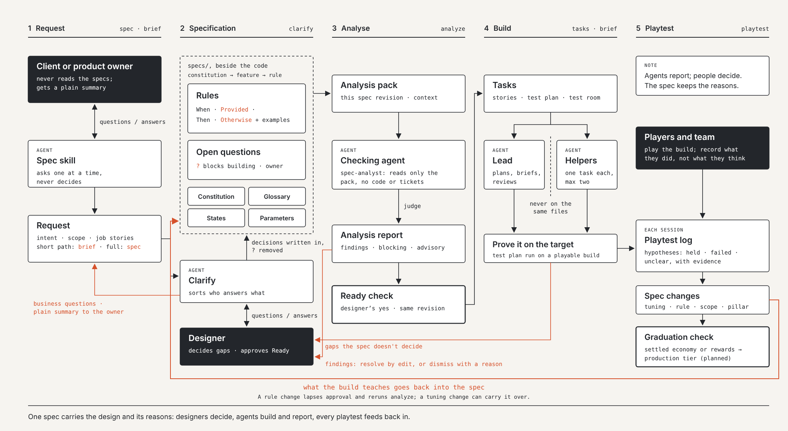

# Design-led SDD

**Spec-driven development for game teams working with AI agents, led by design.** Design leads, code follows, and every playtest feeds back into the spec, with the reasons kept.



Most spec-driven tools assume software: write a spec, plan, build, done. Games find their design by being played, so the spec has to change after every playtest without losing why. This method keeps the discipline of a spec (agents build from it, gaps are visible, decisions are written down) and adds the loop games need. It ships as a Claude Code plugin marketplace.

| Plugin | Tier | Status |
| --- | --- | --- |
| `dl-prototype` | Prototype: light specs for finding the fun | 0.3.0 |
| `dl-production` | Production: rules kept true across many changes | Planned |

## Read

| | |
| --- | --- |
| [Method guide](docs/method-guide.md) | The whole method in nine sections |
| [Worked example](docs/worked-example.md) | One feature taken once round the loop, from request to playtest, with [every step as files](examples/tidepool-keeper/README.md) |
| [Design notes](docs/design-notes.md) | What was taken from Spec Kit and Proviso, what was left, and why |
| [Cheat sheet](docs/cheat-sheet.pdf) | One A4 page: skills, rule format, gates ([HTML](docs/cheat-sheet.html), [PNG](docs/cheat-sheet.png)) |
| [Method flow](docs/dl-prototype-flow.svg) | The diagram above, as an editable SVG |
| [The loop](docs/dl-prototype-loop.svg) | Two starts, two paths and the playtest feedback line |
| PDFs | [Method guide](docs/method-guide.pdf), [worked example](docs/worked-example.pdf), [design notes](docs/design-notes.pdf) |
| [Smoke test](docs/smoke-test.md) | Ten checks to run in a live Claude Code session before relying on 0.3 |
| [Landing page](docs/index.html) | The project site, published with GitHub Pages from `docs/` |

## Install

In Claude Code:

```
/plugin marketplace add <this repository's URL or local path>
/plugin install dl-prototype@design-led-sdd
```

To try it without installing: `claude --plugin-dir ./plugins/dl-prototype`

## Two starts

| | New game | Existing game |
| --- | --- | --- |
| Skill | `/dl-prototype:constitution` | `/dl-prototype:adopt` |
| First job | Write down intent: pillars, platforms, boundaries, agent rules | Take stock of existing docs, code and registers; change none of them |
| Feature specs | Written before building | Written when a feature is next changed: spec the change, not the game |

## Eight skills, two agents, five scripts

Each skill runs one step in Claude Code and asks one question at a time, as multiple choice. You can also just describe what you want; the skills load by themselves.

| Skill | What it does |
| --- | --- |
| `constitution` | New game: sets up the constitution, AGENTS.md, open questions, glossary, state file |
| `adopt` | Existing game: drafts the project layer from existing docs, imports open questions, maps old docs to features |
| `spec` | Full path: writes or revises a feature spec |
| `brief` | Short path: one-page brief for a small change, optionally handed to a helper agent |
| `clarify` | Works open questions down, then asks the designer to approve the spec |
| `analyze` | Independent check of one spec revision, by the `spec-analyst` agent; read-only |
| `tasks` | Stories, scenarios tied to rule rows, tasks, a test plan and a test room; each story approved on its own |
| `playtest` | Records a playtest and turns it into spec changes: tuning can keep the approval, a rule change lapses it |

Agents: `spec-analyst` (reviews only what it is given) and `build-checker` (maps rules to code and tests). Scripts in `scripts/` do the checks that must not depend on a model: `ready_check.py`, `spec_rev.py`, `spec_diff.py`, `register.py`, `pointer.py`. They need Python 3 and nothing else.

## Ready, twice

A spec is approved once its open questions are closed and an independent analysis of its current revision has no unresolved blocking finding. Then each story is approved on its own. Any rule change lapses the approval; a tuning change can carry it over. `ready_check.py` checks all of this and says why in plain lines.

## Shift-left QA

Every rule comes with examples, so a tester can start on any feature without a briefing. QA joins at Clarify, the test plan has one case per example row, and a greybox test room is approved before the build.

## What it puts in your project

```
AGENTS.md                     rules for any agent, read first
CLAUDE.md                     @AGENTS.md
specs/
  constitution.md             the game in one screen
  STATE.md                    where the work is; read first every session
  glossary.md                 words with a special meaning
  open-questions.md           every undecided place, with an owner
  sources.md                  existing games: old documents mapped to features
  features/F001-name/         spec.md, analysis reports, tasks.md, test-plan.md,
                              test-room.md, summary.md, playtest-log.md
  briefs/B001-name.md         short-path changes
  overrides/templates/        your versions of any template; these win
```

## Repository layout

```
.claude-plugin/marketplace.json     the marketplace
plugins/dl-prototype/
  .claude-plugin/plugin.json
  principles/                       the method, for people
  templates/                        the shapes the skills fill in
  skills/                           the procedures, for agents
  agents/                           spec-analyst, build-checker
  scripts/                          Ready check, revisions, diffs, register
docs/                               landing page, guides, cheat sheet, diagram
examples/tidepool-keeper/           a fictional game, one checkpoint per step
tests/                              tests for the scripts and the checkpoints
tools/build_docs.py                 rebuilds docs/*.html from the Markdown
tools/make_flow.py, make_loop.py    regenerate the two diagrams as SVG
tools/make_fixture.py               rebuilds the Tidepool Keeper checkpoints
CHANGELOG.md
```

Run the tests with `python3 -m unittest discover -s tests`.

After editing a guide's Markdown in `docs/`, run `python3 tools/build_docs.py` to refresh its HTML page. The PDFs are printed from those HTML pages.

## Where it comes from

- A studio's working method from a mobile game in production: the AI-first loop, job stories with Gherkin criteria, Definitions of Ready and Done, the open questions register.
- [GitHub Spec Kit](https://github.com/github/spec-kit): the constitution, the clarify and analyse gates, short and full paths, tasks handed to tickets, layered overrides, new and existing project starts.
- [Proviso](https://github.com/bbak/proviso) by Bruno Baketarić: guarded rules with `Otherwise`, undecided places that block building, who decides what, and checking agents kept apart from the work. The production tier will draw on it further.

## Licence

Not yet decided. All rights reserved until a licence is added.

Design-led SDD is by Rob Sandberg.
