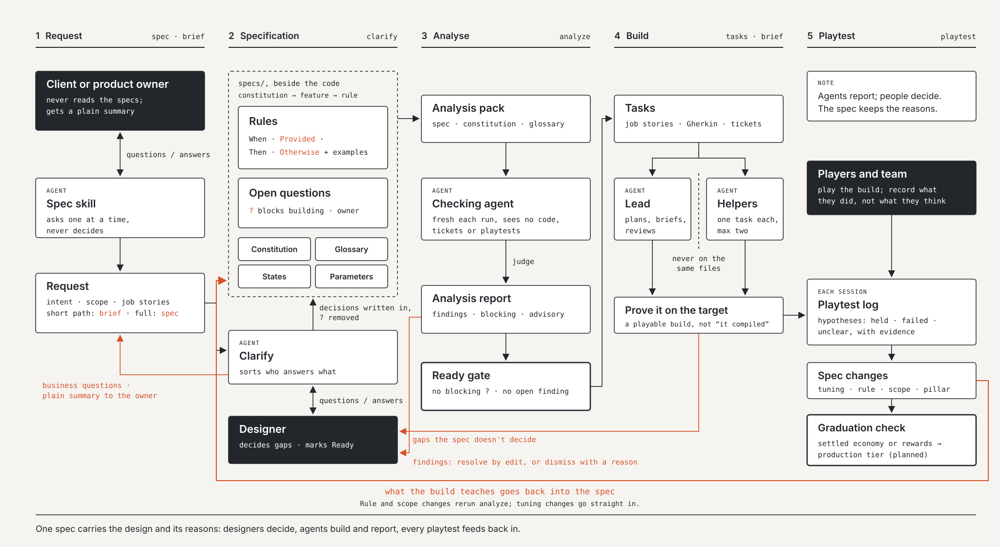
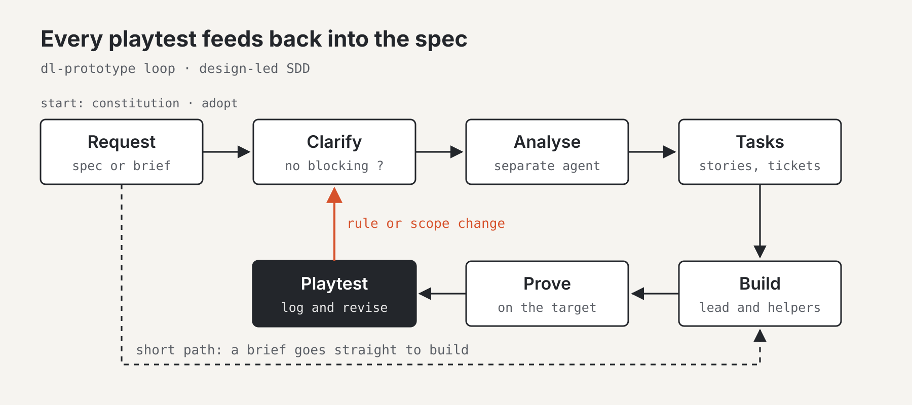

# Design-led SDD: Method guide

Design-led SDD is a spec-driven method for game teams working with AI agents, where design leads and code follows. Games find their design by being played, so the spec has to change after every playtest without losing the reasons behind it. This guide covers the prototype tier, shipped as the Claude Code plugin `dl-prototype` 0.2.1; a production tier for rules that must stay true across many changes is planned.

Sections 1 to 6 describe the method, section 7 the skills that run it, and section 8 what it puts in a project.



## 1. The loop

The designer directs and decides; agents do most of the hands-on work, and every build feeds back into the spec.



A feature spec runs the top row before anything is built; a brief takes the dashed short path. A playtest that changes a rule or scope sends the spec back through Clarify.

**Three rules**

1. **Give the agent hands on the real project:** editor, builds, logs, data. An agent that can only edit files is guessing.
2. **Prove it on the real target:** a device, an emulator, a playable build. "It compiled" is not proof.
3. **Write down what you learn the same day, with the reason.** Every mistake becomes a rule.

**The loop**

1. **Spec first.** Search the specs; settle small gaps, raise real design decisions as open questions.
2. **Choose the path:** a brief for a small change, a feature spec for a new feature or system.
3. **Clarify.** No feature leaves Draft with a blocking open question.
4. **Analyse** the spec against the constitution, glossary and other specs.
5. **Break it down** into job stories with acceptance criteria.
6. **Build** on a branch, in slices that can be played.
7. **Prove it** on the target, then review. Never ship what you cannot explain.
8. **Playtest and revise.** What the build teaches goes back into the spec.
9. **Write it down:** state file, decisions, new rules.

Steps 6 to 8 repeat until the feature is fun. The spec then records why it is the way it is.

**Two paths**

| | Short path | Full path |
| --- | --- | --- |
| Use for | A fix, a tweak, a tuning pass, one slice of a feature | A new feature or system, anything another discipline builds on |
| Artefact | One brief | Feature folder: spec, tasks, playtest log |
| Gates | Read the constitution; prove it on the target | Clarify, analyse, ready check, prove, playtest |
| Skills | `brief` | `spec`, `clarify`, `analyze`, `tasks`, `playtest` |

If a brief grows past one page, it is a feature.

**Roles**

| Role | Does |
| --- | --- |
| Designer or producer | Priorities, design calls, approves anything irreversible or public, reviews what ships |
| Lead agent | One long session: plans, writes briefs, reviews, keeps specs and the state file current |
| Helper agents | One briefed task each, then stopped; at most two at once, never on the same files |
| Scheduled agent | Runs on a timer for checks and summaries |

## 2. Two starts: a new game or an existing one

Before the loop, a project takes one of two starts, because the truth lives in different places.

| | New game | Existing game |
| --- | --- | --- |
| Where the truth is | In people's heads and a pitch | Spread across code, design docs, tickets, wikis and the build |
| Skill | `constitution` | `adopt` |
| Constitution | Built from questions | Drafted from existing docs and code, then confirmed |
| Glossary | Invented as you go | Pulled from code and UI; mismatches become open questions |
| Open questions | Start empty | Imported from existing registers, plus contradictions between docs |
| Feature specs | Written before building | Written when a feature is next changed |
| Biggest risk | Specs that never meet a build | Specs that describe the game as documented, not as built |

**Spec the change, not the game.** On an existing game, never backfill specs for everything. A feature gets a spec the first time it is changed, written from the current build plus the change. Untouched features stay in their old documents, mapped in `specs/sources.md`.

**The build beats the document.** When an old document and the build disagree, record what the build does, raise the disagreement as an open question, and let the designer decide.

## 3. Who decides

Agents write faster than anyone can review, so every call has a named owner and every call lands in a spec.

| Who | Decides | Never |
| --- | --- | --- |
| Client or product owner | What the game should do, what a word means, what is in or out of scope | Has to read the specs to approve; gets a plain summary instead |
| Designer | How a request becomes a spec, every design gap the agents find, playtest conclusions | Leaves a decision in a chat or a head |
| Producer | Priority, scope per milestone, what is ready, what is done | Overrides a spec silently |
| Agents | Nothing about the game; they report what the spec did not decide | Fill a design gap with a guess and carry on |

- An agent that meets a gap stops and reports it, with a recommendation. It takes a default only where the constitution lists the call as an agent call.
- Business questions go to the owner. The place stays open (`?`) until they answer.
- Every hole ends decided in the spec, or open in the register with an owner.
- Spec conflicts are raised as open questions, never resolved quietly.
- Questions are asked one at a time, as multiple choice with the recommended option first.

## 4. Ready and done

Work that does not meet Ready stays in the queue; work that does not meet Done does not move to Done. Work that fails review never moves backwards: the rework is a new item.

**A feature spec is Ready when**

1. Intent, player experience and scope (in and out) are written
2. Every rule has at least one example
3. No blocking open question is still Open
4. Every special term is in the glossary
5. `analyze` has run on its final state with no unresolved finding
6. The designer has marked it Ready

**Any task is Ready when** its title follows the naming convention, it links to its spec or brief, it has at least three acceptance criteria (what, not how), its parent story is linked, and its dependencies are done or accepted as a risk.

**Any task is Done when** every acceptance criterion is verified on the target, a second person or a separate checking agent has reviewed it, no known defect blocks the next discipline, a one-sentence completion note exists, and any deviation from the spec is written into the spec or raised as an open question.

**A story is Done when** all its tasks are Done, the player can do what the job story says in a playable build, a designer or producer has played it, and its happy path, guard and error scenarios pass.

## 5. Writing specs

Specs serve two readers at once: an agent that builds from them without asking, and a person who scans them in minutes.

**Job stories, not user stories.** *When* [situation], *I want to* [goal], *so I can* [outcome]. The When is a real situation, not a role. One job story per ticket.

**Rules with a guard.** A rule says what happens when a condition holds and what happens when it does not. The second half is where most game bugs live.

```gherkin
Rule: The daily gift can be claimed once per day
  When      the player opens the gift panel
  Provided  the player has not claimed today's gift
  Then      the claim button is active
  Otherwise the button shows the time until the next gift
```

Under each rule, an examples table gives concrete cases on both sides of the guard:

| situation | provided | outcome |
| --- | --- | --- |
| first open today | yes | button active |
| claimed at 09:00, opens at 09:05 | no | "Next gift in 14h 55m" |

**Undecided places.** Mark anything undecided with `?` inline and add a row to the open questions register. Nothing with a blocking `?` is built.

**Conventions**

| Item | Convention |
| --- | --- |
| Open question IDs | `OQ-F003-002` per feature, `OQ-NNN` project-wide; status Open, Resolved: answer, or Deferred |
| Changelog rows | Date, what changed, who; newest at the top |
| Risks | "If [condition], then [consequence]." |
| Numbering | Highest in the prefix group plus one; 90 to 99 reserved for registers and indexes |
| Vocabulary | Player word and code word both in the glossary |
| Authorship | Role titles, never agent names, in anything outsiders read |

## 6. Two tiers

A game changes character as it moves from finding the fun to running live, so the method has a light tier and a strict one.

| | Prototype tier (`dl-prototype`) | Production tier (planned) |
| --- | --- | --- |
| Purpose | Find the fun fast, keep decisions visible | Keep rules true across many changes |
| Spec shape | Feature folders, guarded rules where they matter | Spec tree of capabilities, features and rules with stable IDs |
| Change control | Specs revised after each playtest | Every change an amendment on a branch, diffed against a baseline |
| Checking | `analyze` reads specs for consistency | Mechanical impact analysis plus an independent checking agent |
| Testing | Played on the target against acceptance criteria | Independent testing and coding agents; tests checked with mutants |
| Overhead | Low | High, on purpose |

**A feature graduates when** getting a rule wrong costs real money or trust (economy, rewards, purchases, ads, progression, outcome resolution, age gates, consent); when other features keep breaking as it changes; when it is live and changed by people who did not design it; or when playtests only change its tuning values.

Feel and visual work (layout, juice, animation, art direction) stays in the prototype tier for the life of the game.

**Writing for graduation now** keeps the move cheap: guarded rules with an `Otherwise`, a stable ID per rule (`F003.claim-once`), and tuning values in the Parameters table, not in rule text.

## 7. The eight skills

Each skill runs one step in Claude Code, asks one question at a time, and writes into the project's `specs/` folder.

| Skill | Does | Use when | Gate it enforces |
| --- | --- | --- | --- |
| `constitution` | Sets up the constitution, AGENTS.md, open questions, glossary and state file | Starting a new game, or changing pillars, platforms or agent rules | Every agent reads the constitution first |
| `adopt` | Takes stock of an existing game, drafts the project layer from its docs, imports open questions, maps old docs to features | Bringing the method into a game already in development or live | Changes nothing that already exists |
| `spec` | Writes or revises a feature spec, full path | A new feature, mechanic, system or screen flow | Undecided places marked `?`, never guessed |
| `brief` | Writes a one-page brief and can hand it to a helper agent, short path | A fix, tweak, tuning pass or single slice | Must end with proof on the target |
| `clarify` | Works through open questions and finds unmarked gaps | Blocking questions remain, or answers come back | No Ready while a blocking question is Open |
| `analyze` | Checks a spec against the constitution, glossary and other specs, as a separate agent | Before Ready, after a revision or playtest change | No Ready with an unresolved blocking finding |
| `tasks` | Turns a Ready spec into job stories, Gherkin criteria and tasks per discipline | The team needs tickets | Only Ready specs; no criteria the spec does not support |
| `playtest` | Records a session and turns it into spec changes | After anyone plays a build | Rule and scope changes rerun `analyze` |

## 8. Project layout and customising

The plugin holds the method; each project holds its own specs beside its code.

| Path | Holds |
| --- | --- |
| `AGENTS.md` | Rules for any agent, read first; `CLAUDE.md` points to it |
| `specs/constitution.md` | The game on one screen: pillars, platforms, boundaries, agent calls |
| `specs/STATE.md` | Where the work is; replaced, not appended |
| `specs/glossary.md` | Player words and code words with a special meaning |
| `specs/open-questions.md` | Every undecided place, with owner and blocking flag |
| `specs/sources.md` | Existing games only: old documents mapped to features |
| `specs/features/F001-name/` | `spec.md`, `tasks.md`, `playtest-log.md`, dated analysis reports |
| `specs/briefs/B001-name.md` | Short-path changes |
| `specs/overrides/templates/` | The project's own versions of any template |

**Three layers, highest first:** project overrides in `specs/overrides/templates/`; the project layer (constitution, glossary, specs); the method (this plugin's principles and templates). Projects update the plugin for improvements and never edit it in place.

## Where it comes from

| Source | What the method takes |
| --- | --- |
| Gamefuel Studio's working method on a mobile game | The AI-first loop, job stories with Gherkin criteria, Definitions of Ready and Done, the open questions register, spec conventions |
| [GitHub Spec Kit](https://github.com/github/spec-kit) | The constitution, the clarify and analyse gates, a short and a full path, tasks handed to tickets, layered template overrides, greenfield and existing-system starts |
| [Proviso](https://github.com/bbak/proviso) by Bruno Baketarić | Guarded rules with `Otherwise`, undecided places that block building, who decides what, checking agents kept apart from the work; the production tier will draw on it further |
